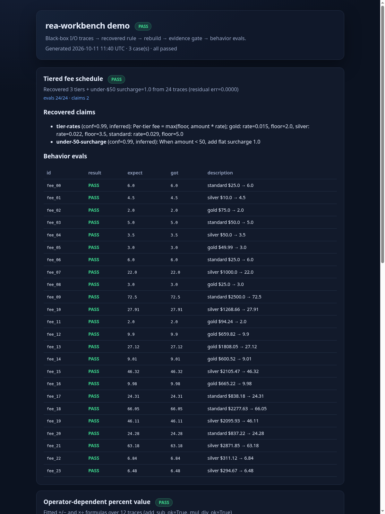
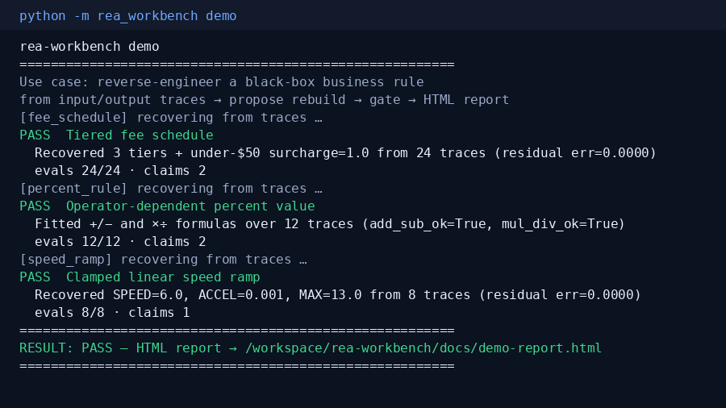

# rea-workbench

[](https://github.com/BrickerP/rea-workbench/actions/workflows/ci.yml)

**You have a black-box business rule and a pile of input→output traces. This workbench recovers the rule, proposes a rebuild, validates evidence claims, runs behavior evals, and emits a pass/fail HTML report — in one command.**



> Not another empty CI framework. A product you can try in under two minutes. The gate library it consumes is [`rea-rebuild-gate`](https://github.com/BrickerP/rea-rebuild-gate).

## The problem

Teams reverse-engineer fees, percent buttons, ramps, and other opaque rules from production behavior. Agents then rewrite. A demo that “runs” is not enough: you need **recovered claims with confidence**, **a rebuild that matches the traces**, and a **human-readable audit** before you ship.

## Try it (< 2 minutes)

Stdlib Python 3.10+. No install, no API keys, no network.

```bash
git clone https://github.com/BrickerP/rea-workbench.git
cd rea-workbench
PYTHONPATH=src:vendor python3 -m rea_workbench demo
```

Open `docs/demo-report.html` in a browser.

```
RESULT: PASS — HTML report → docs/demo-report.html
```

What the demo owns end-to-end:

| case | traces | recovered rule | evals |
|---|---|---|---|
| `fee_schedule` | 24 | 3 tiers (rate+floor) + under-$50 surcharge | 24/24 |
| `percent_rule` | 12 | `+/−` vs `×÷` percent value formulas | 12/12 |
| `speed_ramp` | 8 | SPEED / ACCELERATION / MAX_SPEED clamp | 8/8 |



## What one run does

1. **Load I/O traces** (fixtures generated locally; your own JSON works too).
2. **Recover** a candidate rule from traces only (black-box source never imported into the rebuild).
3. **Propose** `rebuild.py` + `evidence.json` + `evals.json`.
4. **Gate** via vendored [`rea-rebuild-gate`](https://github.com/BrickerP/rea-rebuild-gate): confidence floor, claim→eval coverage, behavior evals.
5. **Emit** `docs/demo-report.html` with PASS/FAIL, claims, and per-eval rows.

## Your own traces

```bash
PYTHONPATH=src:vendor python3 -m rea_workbench run fee_schedule \
  --traces path/to/traces.json \
  --out /tmp/fee-art \
  --report /tmp/fee-report.html
```

Trace shape:

```json
[
  {"id": "t1", "input": {"amount": 100, "tier": "gold"}, "output": 2.0}
]
```

Supported recoverers today: `fee_schedule`, `percent_rule`, `speed_ramp`.

## Layout

```
src/rea_workbench/   # product: recover → propose → gate → report
vendor/              # rea-rebuild-gate (dependency, not the product)
fixtures/traces/     # sample I/O traces
docs/                # demo HTML + screenshots from our run
reports/             # latest artifacts
```

## Development

```bash
PYTHONPATH=src:vendor python3 -m unittest discover -s tests -v
PYTHONPATH=src:vendor python3 -m rea_workbench demo
```

## Author

Built by Yupeng Lu — AI agent & backend engineer. I take agents from demo to production: MCP tools, guardrails, evals, billing, real-time systems.

**Hire me:** https://brickerp.github.io/hire/

MIT License.
